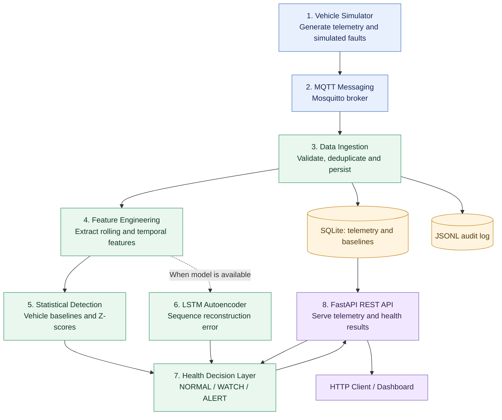

# EdgePulse — Vehicle Telemetry & Fleet Health Platform

A backend IoT and machine learning project simulating a real-time vehicle telemetry pipeline. EdgePulse ingests MQTT telemetry, stores it in SQLite, extracts temporal features, runs two complementary anomaly detectors, and combines their outputs into a deterministic per-vehicle health decision — all exposed through a FastAPI REST API.

Built to demonstrate backend engineering, IoT messaging, time-series ML, statistical signal processing, evaluation methodology, and system design.

> **Data source**: All vehicle telemetry is generated by a software simulator. No real vehicles are connected.

---

## Table of Contents

- [Project Overview](#project-overview)
- [Key Features](#key-features)
- [Technology Stack](#technology-stack)
- [Architecture](#architecture)
- [End-to-End Data Flow](#end-to-end-data-flow)
- [Phase-Wise Implementation](#phase-wise-implementation)
- [Anomaly Detection](#anomaly-detection)
- [Evaluation Results](#evaluation-results)
- [API Reference](#api-reference)
- [Installation](#installation)
- [Running the Pipeline](#running-the-pipeline)
- [LSTM Training and Evaluation](#lstm-training-and-evaluation)
- [Testing](#testing)
- [Repository Structure](#repository-structure)
- [Limitations](#limitations)
- [Engineering Concepts Demonstrated](#engineering-concepts-demonstrated)

---

## Project Overview

Modern vehicles generate continuous sensor streams — engine temperature, RPM, speed, battery voltage, fuel level. Detecting anomalies early matters, but raw sensor values alone are not enough: a spike in RPM during hard acceleration is normal; the same spike at idle is not.

EdgePulse addresses this by:

1. **Ingesting** telemetry over MQTT and persisting it durably.
2. **Engineering temporal features** (rolling statistics, rates of change, cross-signal ratios) per vehicle.
3. **Building per-vehicle statistical baselines** online using Welford's algorithm, then scoring current observations against those baselines.
4. **Training an LSTM autoencoder** offline on normal driving patterns, then flagging sequences whose reconstruction error exceeds a calibrated threshold.
5. **Combining both signals** with hard sensor limits into a single, explainable health status — `NORMAL`, `WATCH`, or `ALERT` — per vehicle.

---

## Key Features

| Feature | Description |
|---|---|
| MQTT ingestion | Paho-MQTT consumer, QoS 1, automatic reconnect, deduplication via `message_id` |
| Telemetry persistence | SQLite with WAL mode, idempotent migrations, JSONL audit log |
| Edge feature engineering | 20+ rolling and rate-of-change features computed per observation |
| Per-vehicle statistical baselines | Online Welford algorithm, outlier rejection, SQLite-backed persistence |
| Z-score deviation scoring | INSUFFICIENT\_DATA / NORMAL / ELEVATED / SEVERE per feature |
| LSTM autoencoder | Encoder-decoder trained on healthy sequences; MSE reconstruction error |
| Leakage-free evaluation | Preprocessing fitted on healthy training data; threshold calibrated on healthy validation only |
| Deterministic health decisions | Pure function combining both detectors and hard sensor limits with explicit precedence |
| FastAPI REST API | Read-only endpoints for telemetry, features, baselines, scores, LSTM results, and health |
| 412 tests | Unit, integration, and pipeline tests covering all modules |

---

## Technology Stack

| Layer | Technology |
|---|---|
| Language | Python 3.12 |
| MQTT | paho-mqtt 2.1.0 |
| API framework | FastAPI 0.115.0, Uvicorn 0.30.6 |
| Data validation | Pydantic 2.9.2 |
| Database | SQLite (stdlib), WAL mode |
| ML framework | PyTorch (LSTM autoencoder, CPU-only capable) |
| Numerical computing | NumPy |
| Configuration | python-dotenv 1.0.1 |
| Testing | pytest 8.3.3, pytest-mock, httpx |
| Message broker | Mosquitto (external, required to run the live pipeline) |

> PyTorch and NumPy are required for LSTM training and evaluation but are **not** listed in `requirements.txt` (they are installed separately due to size). All other dependencies are in `requirements.txt`.

---


## Architecture

EdgePulse is organised into eight logical layers. The ingestion pipeline processes incoming telemetry, two complementary detectors analyse vehicle behaviour, and a deterministic decision layer produces the final health assessment.



**Architecture notes**

- The consumer persists raw telemetry before running the feature pipeline.
- Statistical baseline updates and Z-score scoring operate independently of LSTM inference.
- LSTM inference is optional at runtime; statistical scoring and raw telemetry persistence can continue without a trained model.
- The health decision layer applies explicit rules and returns human-readable reasons and supporting evidence.
- The API reconstructs features from stored telemetry and obtains the LSTM result from the in-process scorer when available.
- The project currently uses simulated telemetry rather than physical vehicle sensors.

---

## End-to-End Data Flow

### 1. Vehicle Simulation

The simulator generates a telemetry record approximately every second per vehicle. Records contain sensor readings such as speed, RPM, engine temperature, battery voltage, and fuel level. Configurable fault injection creates scenarios for offline evaluation.

### 2. MQTT Messaging

The simulator publishes telemetry as JSON through the Mosquitto MQTT broker. The Python consumer subscribes to the configured topic using Paho-MQTT. QoS 1 provides at-least-once delivery, so duplicate messages must be handled by the application.

### 3. Data Ingestion and Persistence

The consumer validates incoming messages, adds missing ingestion metadata and a message ID, and writes raw telemetry to SQLite using `INSERT OR IGNORE`. It also appends records to a JSONL audit log.

After a successful database insertion, the record enters the feature-processing pipeline. Feature-processing failures are caught and logged so they do not interrupt the normal ingestion path.

### 4. Feature Engineering

`FeatureWindow` processes recent observations using a sliding window of up to 60 observations. It calculates rolling statistics, slopes, rates of change, and other temporal features using event timestamps.

These features describe recent vehicle behaviour rather than relying only on individual sensor readings.

### 5. Statistical Anomaly Detection

`VehicleBaseline` maintains per-vehicle, per-feature running statistics using Welford's algorithm and persists baseline state to SQLite.

`score_all_features` calculates Z-scores against the baselines and classifies feature deviations as `NORMAL`, `ELEVATED`, or `SEVERE`. Features without enough baseline samples remain `INSUFFICIENT_DATA`.

### 6. LSTM Autoencoder Anomaly Detection

When a trained model is available, `AnomalyScorer` maintains a bounded sequence buffer for each vehicle. Once 30 observations are available, the LSTM autoencoder reconstructs the sequence and calculates its mean squared reconstruction error.

The error is compared with a threshold calibrated using healthy validation sequences. A score above the threshold flags a potentially anomalous temporal pattern.

### 7. Deterministic Health Decision

`assess_vehicle_health()` combines hard sensor limits, statistical scores, and available LSTM results using explicit precedence rules.

The function produces one of three vehicle-health statuses:

- `NORMAL`: no configured warning or alert condition is triggered by the available evidence.
- `WATCH`: an elevated deviation is detected or LSTM evidence is unavailable or incomplete.
- `ALERT`: a hard sensor limit is crossed, a severe statistical deviation is detected, or the LSTM flags an anomaly.

Non-normal assessments include human-readable reasons and structured supporting evidence.

### 8. FastAPI REST API

FastAPI exposes read-only endpoints for telemetry, feature vectors, baselines, statistical scores, LSTM status, and vehicle health.

For `GET /health/{vehicle_id}`, the API reconstructs features by replaying stored telemetry, obtains the available LSTM result from the in-process scorer, applies the health decision rules, and returns a structured JSON assessment.

### Runtime Considerations

- Raw telemetry and statistical baselines are persisted, but LSTM sequence buffers are held in memory and must warm up again after a relevant process restart.
- LSTM inference is optional, so the statistical pipeline can continue when a trained model is unavailable.
- JSONL provides an additional audit trail, but it is not a guarantee against all storage failures.
- All telemetry and evaluation results are based on synthetic scenarios; real-world detection performance has not yet been established.

---

## Phase-Wise Implementation

### Phase 1 — Simulation and Ingestion ✅

- Multi-vehicle simulator (`simulator/`) with configurable fault injection: `COOLING_DEGRADATION`, `RPM_INSTABILITY`, `BATTERY_DEGRADATION`, `SENSOR_DRIFT`.
- Fault lifecycle: `STARTING → ACTIVE → RECOVERING → RESOLVED`.
- Ground-truth labels exported alongside telemetry for offline evaluation.
- MQTT consumer with QoS 1, reconnect logic, deduplication, JSONL audit log.
- SQLite persistence with WAL mode and idempotent Phase 2 schema migration.

### Phase 2 — Feature Engineering and Statistical Baselines ✅

- **`edge/features.py`**: Rolling mean, min, max, std, slope (°C/min), RPM variability, speed change rate, voltage trend, fuel rate, idle duration — all using actual elapsed time from `event_timestamp`.
- **`edge/baseline.py`**: Per-vehicle Welford baseline, outlier rejection at 5σ, duplicate/out-of-order timestamp rejection, SQLite persistence, process-restart recovery.
- **`edge/scoring.py`**: Z-score deviation with variance floor, produces `INSUFFICIENT_DATA / NORMAL / ELEVATED / SEVERE` per feature.
- **`edge/pipeline.py`**: Wires all of the above; called after raw telemetry is persisted. All failures are caught and logged — telemetry persistence is never interrupted.

### Phase 3 — LSTM Autoencoder Anomaly Detection ✅

- **`lstm/model.py`**: Encoder-decoder LSTM autoencoder. Input `(batch, seq_len=30, 12 features)`, hidden dim 32, MSE reconstruction loss. CPU-only capable.
- **`lstm/dataset.py`**: Leakage-safe split construction, median imputation, MinMax scaling — all fitted on healthy training data only.
- **`lstm/train.py`**: Offline training with early stopping, best-checkpoint restoration, deterministic with seeds.
- **`lstm/artifacts.py`**: Atomic save/load of model weights, imputer/scaler parameters, threshold, and metadata as JSON.
- **`lstm/inference.py`**: Threshold calibration at the 95th percentile of healthy validation errors. Per-vehicle bounded sequence buffer. `AnomalyScorer` — push one feature vector at a time, score when buffer reaches `seq_len`.
- **`lstm/evaluate.py`**: Comparative evaluation vs Phase 2, sequence-level and event-level metrics, Markdown report generation.

### Phase 4 — Deterministic Health Decision Layer ✅

- **`edge/health.py`**: Pure function `assess_vehicle_health()`. No I/O, no ML, deterministic.
- **Decision precedence (highest to lowest)**:
  1. Hard sensor limits: engine_temp ≥ 115 °C, battery_voltage ≤ 11 V, rpm ≥ 8000 → `ALERT`
  2. Phase 2 SEVERE z-score (|z| ≥ 3.5) → `ALERT`
  3. LSTM `is_anomalous=True` → `ALERT`
  4. Phase 2 ELEVATED z-score (|z| ≥ 2.0) → `WATCH`
  5. LSTM warming up, no threshold, or inference error → `WATCH`
  6. All signals within normal range → `NORMAL`
- Unavailable LSTM output is **never** treated as proof of health — it is noted in `reasons`.
- Every non-NORMAL response includes human-readable `reasons` and a structured `evidence` dict.
- Integrated into `GET /health/{vehicle_id}` in the FastAPI layer.

### Phase 5 — Interactive Architecture Explainer ⬜ (not started)

---

## Anomaly Detection

EdgePulse runs two complementary detectors that operate independently and are combined in Phase 4.

### Statistical Detector (Phase 2)

For each vehicle, a separate baseline is maintained per feature using Welford's online algorithm. At each timestep, the z-score of the current feature value against the vehicle's own baseline is computed:

```
z = (current_value − baseline_mean) / max(baseline_std, 0.1)
```

A variance floor (`0.1`) prevents division by near-zero standard deviation for stable features like battery voltage.

**Strengths**: Zero training time, immediate per-feature interpretability ("engine_temp is 4.2 σ above this vehicle's norm"), 100% recall on the test set.

**Weaknesses**: Treats each feature independently; cannot detect multi-feature temporal patterns. Produces false positives when the baseline is not yet converged (seen in evaluation: 107 FP sequences, FPR 0.60).

### LSTM Autoencoder (Phase 3)

The model is trained exclusively on healthy driving sequences. During inference, it reconstructs the input sequence and computes the mean squared error between the original and reconstructed sequence. A high reconstruction error indicates that the observed temporal pattern is unusual relative to the healthy patterns seen during training.

```
reconstruction_error = MSE(input_sequence, reconstructed_sequence)
is_anomalous = reconstruction_error > threshold
```

The threshold is the 95th percentile of reconstruction errors on healthy validation sequences — calibrated entirely without test data.

**Strengths**: Learns cross-feature temporal patterns; zero false positives on the test set (precision 1.000).

**Weaknesses**: Requires offline training; 30-observation warm-up before the buffer fills; lower recall (0.639) — some fault types produce gradual shifts the model does not flag.

### Why both?

| Property | Statistical (Phase 2) | LSTM (Phase 3) |
|---|---|---|
| Training required | No | Yes (offline) |
| Warm-up | ~30 samples | 30 observations (seq_len) |
| Interpretability | Per-feature z-score | Sequence-level error |
| Recall on test set | 1.000 | 0.639 |
| Precision on test set | 0.958 | 1.000 |
| FPR on test set | 0.605 | 0.000 |

Neither detector is strictly better. Phase 4 uses ALERT precedence: if either detector flags an anomaly, the vehicle is in ALERT — the statistical detector catches more faults; the LSTM catches them with higher confidence.

---

## Evaluation Results

Evaluated on a **synthetic** fault-mode simulation: 3 vehicles × 900 steps, 3 fault events, seeds isolated across train/validation/test. Preprocessing (imputer, scaler) fitted on healthy training data only. Threshold calibrated on healthy validation data only. Test data never touches training or calibration.

### Sequence-Level Results

> Each overlapping sliding window is counted as one unit. Consecutive windows over the same fault episode inflate TP counts. Event-level results below provide the fault-detected-per-event view.

| Metric | LSTM Autoencoder | Statistical Baseline |
|---|---|---|
| TP | 1552 | 2430 |
| FP | 0 | 107 |
| TN | 177 | 70 |
| FN | 878 | 0 |
| Precision | **1.0000** | 0.9578 |
| Recall | 0.6387 | **1.0000** |
| F1-score | 0.7795 | **0.9785** |
| False-positive rate | **0.0000** | 0.6045 |

### Per-Fault-Type (sequence-level)

| Fault | Detector | Precision | Recall | F1 |
|---|---|---|---|---|
| BATTERY_DEGRADATION | LSTM | 1.0000 | 0.9247 | 0.9609 |
| BATTERY_DEGRADATION | Phase 2 | 0.8833 | 1.0000 | 0.9380 |
| COOLING_DEGRADATION | LSTM | 1.0000 | 0.4726 | 0.6419 |
| COOLING_DEGRADATION | Phase 2 | 0.8870 | 1.0000 | 0.9401 |
| RPM_INSTABILITY | LSTM | 1.0000 | 0.5205 | 0.6847 |
| RPM_INSTABILITY | Phase 2 | 0.8794 | 1.0000 | 0.9358 |

### Event-Level Results (3 fault events, 3 vehicles)

| Vehicle | Fault | LSTM Detected | LSTM Delay | Phase 2 Detected | Phase 2 Delay |
|---|---|---|---|---|---|
| CAR-01 | COOLING_DEGRADATION | YES | 20 s | YES | 0 s |
| CAR-02 | RPM_INSTABILITY | YES | 207 s | YES | 0 s |
| CAR-03 | BATTERY_DEGRADATION | YES | 7 s | YES | 0 s |

Both detectors found all 3 fault events. The LSTM detection delay reflects the 30-observation warm-up and the time taken for reconstruction error to exceed the threshold after fault onset.

**Caveats**: All data is synthetic. Phase 2 FPR of 0.605 likely reflects incomplete baseline convergence (only 600 training steps). The statistical detector was given the best possible conditions for recall (ELEVATED or SEVERE on any feature counts as a detection). These results should not be interpreted as real-world accuracy.

---

## API Reference

All endpoints are read-only. Data enters through the MQTT consumer only.

| Method | Path | Description |
|---|---|---|
| GET | `/` | Service identity and version |
| GET | `/health` | Database reachability check |
| GET | `/telemetry/latest` | Most recently ingested record |
| GET | `/telemetry` | Recent records (default 20, max 100) |
| GET | `/telemetry/{vehicle_id}` | Recent records for a specific vehicle |
| GET | `/features/{vehicle_id}` | Current feature vector (replayed from stored telemetry) |
| GET | `/baseline/{vehicle_id}` | Per-feature baseline statistics |
| GET | `/scores/{vehicle_id}` | Z-score deviation scores for all features |
| GET | `/lstm/status` | LSTM model availability and threshold status |
| GET | `/lstm/anomaly/{vehicle_id}` | Latest LSTM reconstruction-error result |
| GET | `/health/{vehicle_id}` | **Combined health assessment** (NORMAL / WATCH / ALERT) |

### `/health/{vehicle_id}` response shape

```json
{
  "vehicle_id": "CAR-01",
  "status": "ALERT",
  "reasons": [
    "SEVERE deviation on: engine_temp",
    "LSTM reconstruction error 0.3120 exceeds threshold 0.1045"
  ],
  "evidence": {
    "engine_temp": {
      "z_score": 4.2,
      "level": "SEVERE",
      "current_value": 108.3,
      "baseline_mean": 89.1
    },
    "lstm_reconstruction_error": 0.312,
    "lstm_threshold": 0.1045
  },
  "phase2_scored": true,
  "lstm_status": "scored",
  "lstm_anomalous": true
}
```

---

## Installation

### Prerequisites

- Python 3.12
- Mosquitto MQTT broker (for running the live pipeline)
- PyTorch and NumPy (for LSTM training/inference only)

### Steps

```powershell
# 1. Clone the repository
git clone <repo-url>
cd EdgePulse

# 2. Create and activate a virtual environment
python -m venv .venv
.venv\Scripts\Activate.ps1

# 3. Install core dependencies
pip install -r requirements.txt

# 4. Install ML dependencies (required for LSTM features)
pip install torch numpy

# 5. Copy environment template
copy .env.example .env
# Edit .env if your Mosquitto broker uses a non-default host/port
```

### Environment variables (`.env`)

| Variable | Default | Description |
|---|---|---|
| `MQTT_BROKER_HOST` | `localhost` | Mosquitto host |
| `MQTT_BROKER_PORT` | `1883` | Mosquitto port |
| `MQTT_TOPIC` | `telemetry/vehicle` | Topic to subscribe/publish |
| `DATABASE_PATH` | `edgepulse.db` | SQLite file path |
| `LOG_FILE` | `logs/telemetry.jsonl` | JSONL audit log path |
| `BASELINE_MIN_SAMPLES` | `30` | Samples before baseline is ready |
| `SCORE_WARNING_THRESHOLD` | `2.0` | Z-score for ELEVATED |
| `SCORE_SEVERE_THRESHOLD` | `3.5` | Z-score for SEVERE |

---

## Running the Pipeline

You need three terminals. Start Mosquitto first.

```powershell
# Terminal 1 — MQTT broker (requires Mosquitto installed)
mosquitto

# Terminal 2 — Edge consumer (receives MQTT, persists, runs feature pipeline)
python -m edge.consumer

# Terminal 3 — FastAPI server
uvicorn api.main:app --host 127.0.0.1 --port 8000 --reload

# Terminal 4 (optional) — Simulator (publishes synthetic telemetry)
python -m simulator.publisher
```

Once all four are running, query the API:

```powershell
# Health check
curl http://127.0.0.1:8000/health

# Latest telemetry
curl http://127.0.0.1:8000/telemetry/latest

# Feature vector for a vehicle
curl http://127.0.0.1:8000/features/CAR-01

# Deviation scores
curl http://127.0.0.1:8000/scores/CAR-01

# Combined health assessment
curl http://127.0.0.1:8000/health/CAR-01
```

---

## LSTM Training and Evaluation

The LSTM model is trained offline. No training occurs at runtime.

```powershell
# Train with default settings (seq_len=30, hidden_dim=32, 100 epochs, seed=42)
python -m lstm.train

# Train with custom options
python -m lstm.train --seq-len 30 --hidden-dim 32 --epochs 100 --seed 42 --model-dir models/

# Evaluate (uses existing trained model)
python -m lstm.evaluate

# Retrain and evaluate in one step
python -m lstm.evaluate --retrain --epochs 100

# Full options
python -m lstm.evaluate --model-dir models/ --out-dir evaluation-results/ --test-steps 900
```

Training CLI options:

| Parameter | Default | Description |
|---|---|---|
| `--seq-len` | 30 | Observations per sequence |
| `--hidden-dim` | 32 | LSTM hidden state size |
| `--epochs` | 100 | Maximum epochs |
| `--batch-size` | 32 | Mini-batch size |
| `--lr` | 1e-3 | Adam learning rate |
| `--patience` | 10 | Early stopping patience |
| `--seed` | 42 | Random seed |
| `--model-dir` | `models/` | Artifact output directory |
| `--train-steps` | 600 | Simulation steps for training data |
| `--val-steps` | 600 | Simulation steps for validation data |

Trained artifacts are saved to `models/` (gitignored): `model_weights.pt` and `metadata.json`.

Evaluation outputs are saved to `evaluation-results/` (gitignored): `results.json` and `report.md`.

---

## Testing

```powershell
# Run the full test suite (requires PyTorch and NumPy for LSTM tests)
python -m pytest tests/ -v

# Run only non-LSTM tests (no ML dependencies required)
python -m pytest tests/ -v --ignore=tests/test_lstm_dataset.py --ignore=tests/test_lstm_evaluate.py --ignore=tests/test_lstm_inference.py --ignore=tests/test_lstm_model.py
```

**Verified test count: 412 tests, 0 failures** (run against Python 3.12 with torch 2.12.1 and numpy 1.26.4).

Test coverage by module:

| Test file | Module under test | Focus |
|---|---|---|
| `test_simulator.py` | `simulator/` | State machine, faults, reproducibility, MQTT compatibility |
| `test_consumer.py` | `edge/consumer.py`, `edge/validation.py` | Validation rules, enrichment, rejection paths |
| `test_database.py` | `database/db.py` | Insert, retrieve, deduplication, schema |
| `test_features.py` | `edge/features.py` | Rolling stats, slopes, gap handling, edge cases |
| `test_baseline.py` | `edge/baseline.py` | Welford updates, outlier rejection, serialisation |
| `test_api.py` | `api/main.py` | All Phase 0–2 endpoints, status codes, limits |
| `test_health.py` | `edge/health.py`, `/health` endpoint | All decision paths, evidence, LSTM cases |
| `test_lstm_dataset.py` | `lstm/dataset.py` | Feature extraction, imputer, scaler, sequences |
| `test_lstm_model.py` | `lstm/model.py`, `lstm/train.py`, `lstm/artifacts.py` | Model shapes, gradients, training, save/load |
| `test_lstm_inference.py` | `lstm/inference.py` | Threshold calibration, AnomalyScorer, buffers |
| `test_lstm_evaluate.py` | `lstm/evaluate.py` | Metrics, event extraction, leakage proofs |

---

## Repository Structure

```
EdgePulse/
├── api/
│   └── main.py              # FastAPI application, all routes
├── database/
│   └── db.py                # SQLite persistence layer
├── edge/
│   ├── consumer.py          # MQTT subscriber, telemetry processing
│   ├── features.py          # Feature window and rolling feature extraction
│   ├── baseline.py          # Welford baseline engine
│   ├── scoring.py           # Z-score deviation scoring
│   ├── pipeline.py          # Wires features + baselines + scoring + LSTM
│   ├── health.py            # Phase 4 health decision layer
│   └── validation.py        # Telemetry schema and range validation
├── lstm/
│   ├── model.py             # LSTM autoencoder (encoder-decoder)
│   ├── dataset.py           # Dataset pipeline, imputer, scaler, sequences
│   ├── train.py             # Offline training script and CLI
│   ├── inference.py         # Threshold calibration and AnomalyScorer
│   ├── evaluate.py          # Comparative evaluation pipeline
│   └── artifacts.py         # Atomic model save/load
├── simulator/
│   ├── vehicle.py           # Multi-vehicle simulator with state machine
│   ├── faults.py            # Fault injection and ground-truth labelling
│   └── publisher.py         # MQTT publisher CLI
├── tests/                   # 412 tests across all modules
├── models/                  # Trained artifacts (gitignored)
├── evaluation-results/      # Evaluation reports (gitignored)
├── logs/                    # JSONL audit log (gitignored)
├── config.py                # Centralised configuration with env-var overrides
├── requirements.txt         # Core dependencies (PyTorch/NumPy installed separately)
└── .env.example             # Environment variable template
```

---

## Limitations

- All data is synthetic. No real vehicles or physical sensors are connected.
- LSTM inference is in-memory; restarting the API or consumer resets per-vehicle sequence buffers.
- The LSTM is trained on three simulated vehicles. It may not generalise to different driving profiles without retraining.
- Phase 2 baselines require ≥30 observations per feature before scoring begins. Short runs produce `INSUFFICIENT_DATA` for most features.
- Overlapping sliding windows inflate sequence-level TP/FP counts in evaluation; event-level metrics provide a fairer view.
- No authentication, rate limiting, or multi-tenancy on the API.
- No Docker containerisation, CI/CD, or cloud deployment (planned for future phases).

---

## Engineering Concepts Demonstrated

- **IoT messaging**: MQTT publish/subscribe with QoS 1, deduplication, and reconnect handling.
- **Streaming data processing**: Sliding window feature extraction with gap detection and out-of-order timestamp handling.
- **Online statistics**: Welford's algorithm for numerically stable running mean and variance with outlier rejection.
- **Time-series anomaly detection**: Both unsupervised statistical (z-score) and deep learning (LSTM autoencoder) approaches.
- **Leakage-free ML evaluation**: Train/val/test splits with preprocessing and threshold calibration exclusively on non-test data.
- **Deterministic decision logic**: Pure-function health aggregator with explicit precedence rules and full explainability.
- **Fault isolation**: Every layer (MQTT, DB, feature pipeline, LSTM) isolates failures so raw telemetry is never lost.
- **Persistence and recovery**: SQLite baseline persistence enables process restarts without discarding accumulated history.
- **Test-driven development**: 412 tests covering unit behaviour, integration paths, failure modes, and leakage proofs.
